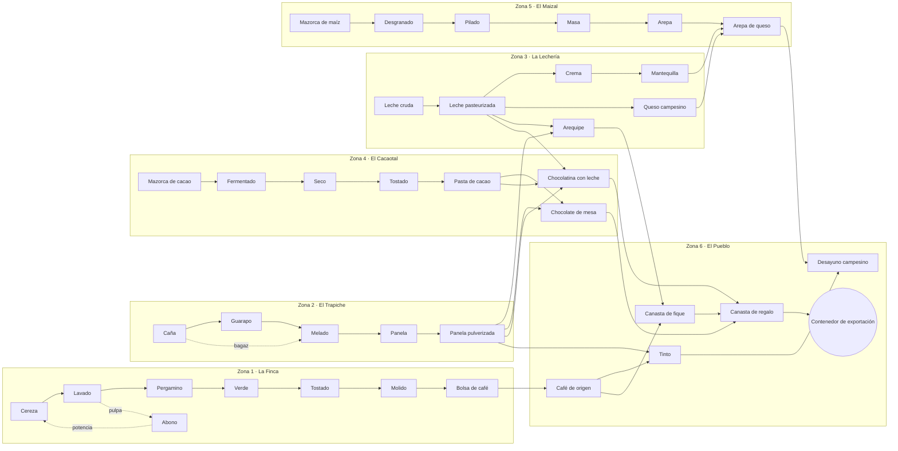

# Cafetal — Documento de Diseño (GDD) v0.3

> Juego incremental de **cadena de suministros**: un recurso inicial ilimitado pero lento alimenta a una estación, esa estación alimenta a la siguiente, y todo se mejora para producir cada vez más.
> De Frozen City solo se toman la cadena de producción visible y el estilo gráfico isométrico «de juguete», con personajes que llevan cargas.
> No hay supervivencia, ni clima hostil, ni población que alimentar, ni héroes.
> Una sola zona que se puede terminar y que se ampliará con actualizaciones. JavaScript (Vite + PixiJS).

---

## 1. Tema

Se buscó un tema en el que una cadena larga de transformación sea **natural y fácil de entender**, en el que cada paso **aumente el valor** del producto y en el que el origen sea **ilimitado**.

| Tema | Fuente ilimitada | Cadena | Notas |
|------|------------------|--------|-------|
| **Cafetal** (finca cafetera de montaña) | Cafeto (cerezas) | cereza → lavado → pergamino → verde → tostado → molido → bolsa | **Recomendado**: cadena real de 7 pasos, muy visual y con mucha identidad |
| Panadería de pueblo | Trigal | trigo → harina → masa → pan → pastel | Más corta, ideal si se quiere algo muy simple |
| Fábrica de chocolate | Cacaotal | cacao → fermentado → tostado → pasta → tableta → bombón | Muy parecida al café; buena como Zona 2 |
| Herrería minera | Veta de mineral | mineral → lingote → barra → pieza → herramienta | Tono más industrial |

**Se elige Cafetal** porque:
- La cadena real del café tiene muchos pasos con nombre propio, cada uno con su edificio reconocible.
- El paisaje cafetero (montañas verdes, niebla, casas de colores con balcones, palmas altas, mulas y jeeps Willys cargados) da un estilo gráfico propio y encantador.
- Las expansiones salen solas: tostaduría en el pueblo, cafetería con bebidas, puerto de exportación, cacao…

---

## 2. Concepto

> *Heredas una ladera con unos pocos cafetos y una mula. Cosecha, procesa y despacha café cada vez mejor hasta llenar tu primer contenedor de exportación.*

- **Género:** incremental / idle de cadena de producción.
- **Vista:** isométrica. La finca baja por la ladera: arriba el cafetal y abajo el pueblo donde se despacha. La cadena se lee de arriba abajo.
- **Sesiones:** cortas (de 2 a 10 min) o dejándolo correr. Ganancias sin conexión con un límite.
- **Zona 1:** de 3 a 5 horas hasta el objetivo final. **Tiene final**: no hay que esperar días.
- **Sin:** héroes, gacha, energía, anuncios ni pagos.

### Pilares
1. **Cada producto alimenta al siguiente.** Siempre se ve qué estación está esperando y cuál se está atascando.
2. **Mejorar siempre se nota.** Cada compra acelera algo de forma visible: más mulas, máquinas más rápidas, números más grandes.
3. **El cuello de botella se mueve.** Si arreglas uno, aparece otro más abajo. Ese es el juego.
4. **Pequeño y terminado.**

---

## 3. Bucle de juego

```
 Cafetal (ilimitado, lento)
      │  cerezas
      ▼
 Estación 2 ─► Estación 3 ─► … ─► Bodega ─► Despacho (Willys) ─► 💰 Monedas
      ▲                                                            │
      └──────────── Mejorar nivel / arrieros / desbloquear ◄───────┘
```

1. El **Cafetal** produce cerezas sin fin, pero despacio.
2. Cada **estación** transforma lo que recibe en un producto de mayor valor.
3. Los **arrieros** (mulas) llevan el producto de una estación a la siguiente.
4. Todo lo que llega a la **Bodega** lo vende el **Despacho** y se convierte en monedas.
5. Con las monedas se **mejora**, se **desbloquean** estaciones y se compran **investigaciones**.

**Decisión clave:** ¿mejoro producción, transporte o venta? El jugador busca el cuello de botella; la UI se lo marca.

---

## 4. La cadena (Zona 1)

| # | Estación | Entra | Sale | Ciclo (nv. 1) | Valor unidad | Desbloqueo | Coste base de mejora |
|---|----------|-------|------|---------------|--------------|------------|----------------------|
| 1 | **Cafetal** ♾️ | — | 1 🍒 cereza | 2 s | 1 | Inicial | 5 |
| 2 | Beneficiadero (despulpar y lavar) | 2 🍒 | 1 💧 grano lavado | 4 s | 3 | 50 | 8 |
| 3 | Marquesina de secado | 1 💧 | 1 🟫 pergamino | 4 s | 6 | 250 | 12 |
| 4 | Trilladora | 1 🟫 | 1 🟢 café verde | 4 s | 10 | 1.000 | 20 |
| 5 | Tostadora | 2 🟢 | 1 🟤 café tostado | 8 s | 30 | 4.000 | 35 |
| 6 | Molino | 1 🟤 | 1 ☕ café molido | 8 s | 45 | 15.000 | 60 |
| 7 | Empacadora | 4 ☕ | 1 🛍️ bolsa de café | 32 s | 250 | 60.000 | 100 |
| — | **Bodega + Despacho** | cualquier producto | 💰 | viaje de 10 s | — | Inicial | 10 |

> **Regla de balance (v0.2):** a igual nivel, cada estación procesa exactamente lo que le entrega la anterior (los ciclos se calcularon a partir de 0,5 🍒/s del Cafetal a nivel 1). Así, subir toda la cadena junta mantiene el flujo equilibrado y el cuello de botella aparece cuando una estación se queda atrás. Simulado: un jugador que sube la cadena en bloque construye la Empacadora a los ~67 min; uno que mejora estación por estación, a las ~2 h 20 min.

- **Al principio solo existen el Cafetal y el Despacho:** se venden cerezas a 1 💰. Desbloquear el Beneficiadero vuelve más rentable cada cereza, y así sucesivamente.
- **Cada paso aumenta el valor** más de lo que consume (2 🍒 = 2 → 1 💧 = 3), así que procesar siempre conviene, **si la estación da abasto**. Si no, el sobrante también se vende en crudo.
- **Desvío automático:** si una estación está llena o bloqueada, su entrada se desvía a la Bodega y se vende tal cual. La cadena nunca se atasca del todo; solo rinde menos. La UI lo muestra con una flecha naranja de desvío.

---

## 4b. Mapa completo de la cadena (todas las zonas)

Esto es el **techo del juego**: todo lo que existirá cuando estén las 6 zonas. Se construye por partes (la v1.0 solo trae la Zona 1), pero el diseño, los datos y el balance se piensan desde el principio para que todo encaje.

### Resumen en números

| Concepto | Cantidad |
|----------|----------|
| Zonas | **6** |
| Fuentes ilimitadas | **5** (cafetal, cañaduzal, potrero, cacaotal, maizal); el Pueblo no tiene |
| Productos en total | **40** |
| Estaciones (edificios de producción) | **38** |
| Subproductos que potencian otras estaciones | 2 (pulpa → abono, bagazo) |
| Productos que combinan varias zonas | 10 |
| Producto final del juego | **Contenedor de exportación** |
| Profundidad máxima (pasos desde una fuente hasta el final) | 10 (de la cereza al contenedor) |

### Vista general



### Detalle por zona

Los valores son orientativos y se ajustarán con el simulador de balance. ⇄ indica un producto importado de otra zona.

#### Zona 1 · La Finca (café) — 8 estaciones, 9 productos — **v1.0**
| # | Estación | Entrada | Salida | Valor |
|---|----------|---------|--------|-------|
| 1 | Cafetal ♾️ | — | Cereza de café | 1 |
| 2 | Beneficiadero | 2 cerezas | Café lavado + *pulpa* | 3 |
| 3 | Marquesina de secado | 1 lavado | Café pergamino | 6 |
| 4 | Trilladora | 1 pergamino | Café verde | 10 |
| 5 | Tostadora | 2 verde | Café tostado | 30 |
| 6 | Molino | 1 tostado | Café molido | 45 |
| 7 | Empacadora | 4 molido | Bolsa de café | 250 |
| 8 | Compostera *(rama opcional, v1.0)* | 4 pulpa (por canaleta, sin mulas) | Compost → todo lo que vende la Finca +30 % mientras haya (1 compost por cada 8 cafés lavados; no acelera ninguna estación, así que no descompensa la cadena) | — |

#### Zona 2 · El Trapiche (caña y panela) — 5 estaciones, 6 productos — **v1.1** ✅
Se abre al completar la Finca. Los productos valen ×5 respecto al primer borrador porque la zona arranca con la economía de la Finca (las monedas se comparten y la Finca sigue produciendo). Misma regla de balance: a igual nivel, cada estación procesa lo que le entrega la anterior.

| # | Estación | Entrada | Salida | Ciclo (nv. 1) | Valor | Desbloqueo | Coste base |
|---|----------|---------|--------|---------------|-------|------------|------------|
| 1 | Cañaduzal ♾️ | — | Caña | 2 s | 10 | Con la zona | 50 |
| 2 | Molienda | 1 caña | Guarapo + *bagazo* | 2 s | 25 | 5.000 | 80 |
| 3 | Hornilla | 2 guarapo (+ bagazo: ×2 de velocidad) | Melado | 4 s | 60 | 25.000 | 120 |
| 4 | Gaveras | 2 melado | Panela | 8 s | 150 | 80.000 | 200 |
| 5 | Pulverizadora | 1 panela | Panela pulverizada | 8 s | 250 | 250.000 | 350 |

- **Bagazo**: la Molienda lo produce (1 por ciclo) y pasa directo a la Hornilla, que va pegada a ella. Mientras la Hornilla tenga bagazo, trabaja ×2 y gasta 1 por ciclo.
- **Investigaciones**: Trapiche con motor (Molienda ×2), Abono para la caña (Cañaduzal ×2), Chiva para el Trapiche (despacho ×2), Gaveras de acero (×2), Panela orgánica (+50 % de valor).
- **Final**: «Primer cargamento de panela», vender 6.000 panelas pulverizadas (15 objetivos; 5.000 hasta la v1.6).
- **Duración medida** (`npm run balance`, v1.3): unos 35 min después de completar la Finca (la Finca, que sigue produciendo, lo acelera mucho).

#### Zona 3 · La Lechería — 6 estaciones, 6 productos — **v1.2** ✅
Se abre al completar el Trapiche. Productos ×25 respecto al primer borrador (el Trapiche iba ×5). Es la primera zona con **ramas**: la leche pasteurizada se reparte entre la Quesera, la Descremadora y la Paila. A igual nivel, la Pasteurizadora da un cuarto a la Quesera, otro a la Descremadora, otro a la Paila y el último a la **Ruta de la leche** del Cacaotal (v1.3), así que la regla de balance se mantiene: con todo al mismo nivel, nada sobra. Mientras falta alguna rama, la leche que sobra se vende sin procesar.

| # | Estación | Entrada | Salida | Ciclo (nv. 1) | Valor | Desbloqueo | Coste base |
|---|----------|---------|--------|---------------|-------|------------|------------|
| 1 | Potrero y establo ♾️ | — | Leche cruda | 2 s | 125 | Con la zona | 250 |
| 2 | Pasteurizadora | 1 cruda | Leche pasteurizada | 2 s | 300 | 200.000 | 400 |
| 3 | Quesera *(rama, ¼ de la leche)* | 4 pasteurizada | Queso campesino | 32 s | 2.400 | 400.000 | 1.300 |
| 4 | Descremadora *(rama, ¼)* | 2 pasteurizada | Crema de leche | 16 s | 800 | 1.000.000 | 600 |
| 5 | Batidora | 2 crema | Mantequilla | 32 s | 2.000 | 2.000.000 | 900 |
| 6 | Paila de arequipe *(rama, ¼)* | 4 pasteurizada + 1 panela pulverizada ⇄ | Arequipe | 32 s | 4.000 | 4.000.000 | 2.000 |

- **Reparto**: las mulas de la Pasteurizadora llevan cada carga a la rama con la entrada más vacía (contando lo que va en camino); la que trabaja más rápido recibe más, sin que el jugador tenga que repartir a mano. La carga se calcula para el viaje a la más lejana.
- **Primera ruta entre zonas — Ruta de la panela** (`src/data/routes.js`, `src/sim/routes.js`): una **Chiva** recoge panela pulverizada en la bodega del Trapiche y la lleva a la Paila (60 s ida y vuelta). Tiene su propio nivel (pestaña 🚌 de la Paila): a igual nivel que la Paila lleva todo lo que gasta (un 25 % más), contando sus investigaciones de velocidad. El Willys del Trapiche no vende la panela que espera la Chiva. Sin panela, la Paila espera; el resto de la Lechería sigue igual.
- **Investigaciones**: Ordeño mecánico y Pasteurizadora de placas (×2, en pareja), Descremadora centrífuga, Batidora eléctrica, Cuajo de calidad, Paila de cobre (×2), Carrotanque (despacho ×2), Queso doble crema y Arequipe de exportación (+50 %).
- **Final**: «Arequipe para todo el pueblo», vender 6.000 arequipes (17 objetivos; 3.000 hasta la v1.6).
- **Duración medida** (`npm run balance`, v1.3): unas 2 h 20 min después de completar el Trapiche.

#### Zona 4 · El Cacaotal (chocolate) — 7 estaciones, 7 productos — **v1.3** ✅
Se abre al completar la Lechería. Productos ×125 respecto al primer borrador. Es la primera zona con **dos importaciones**: la panela del Trapiche (para la Mesa y la Chocolatería) y la leche de la Lechería (solo para la Chocolatería). La pasta de cacao se reparte entre la Mesa y la Chocolatería: a igual nivel, la mitad cada una.

| # | Estación | Entrada | Salida | Ciclo (nv. 1) | Valor | Desbloqueo | Coste base |
|---|----------|---------|--------|---------------|-------|------------|------------|
| 1 | Cacaotal ♾️ | — | Mazorca de cacao | 2 s | 1.000 | Con la zona | 1.500 |
| 2 | Cajones de fermentación | 2 mazorcas | Cacao fermentado | 4 s | 2.500 | 2 M | 2.000 |
| 3 | Secadero | 1 fermentado | Cacao seco | 4 s | 4.400 | 5 M | 3.000 |
| 4 | Tostador de cacao | 1 seco | Cacao tostado | 4 s | 8.800 | 12 M | 4.500 |
| 5 | Molino de cacao | 2 tostado | Pasta de cacao | 8 s | 22.000 | 30 M | 7.000 |
| 6 | Mesa de chocolate *(rama, ½)* | 2 pasta + 1 panela pulverizada ⇄ | Chocolate de mesa | 32 s | 100.000 | 40 M | 10.000 |
| 7 | Chocolatería *(rama, ½)* | 2 pasta + 1 panela pulverizada ⇄ + 4 leche pasteurizada ⇄ | Chocolatina con leche | 32 s | 220.000 | 80 M | 16.000 |

- **Rutas**: la **Ruta de la panela al Cacaotal** abastece a la Mesa y a la Chocolatería (a igual nivel que ellas, lleva lo que gastan las dos y reparte cada carga según el sitio que le queda a cada una). La **Ruta de la leche** lleva leche pasteurizada de la bodega de la Lechería a la Chocolatería. Como el Trapiche ya manda panela a la Lechería, las dos rutas de panela se reparten lo que hay según lo que pide cada una.
- **Las rutas cuadran a igual nivel en todas las zonas**, también al nivel 100 y con todas las investigaciones (hay una prueba): la panela que piden la Paila, la Mesa y la Chocolatería es ¾ de lo que da el Trapiche (el resto se vende), y la Pasteurizadora guarda un cuarto de su leche para la Ruta de la leche, como una rama más: sus mulas la dejan en la bodega, de donde sale la Chiva lechera. Antes de abrir el Cacaotal, ese cuarto se vende como leche.
- **Investigaciones**: Injertos de clones finos y Cajones en escalera (×2, en pareja), Secadero con techo corredizo, Tostador de bombo, Molino de bolas, Moldes de aluminio, Temperadora (×2), Camión para el Cacaotal (despacho ×2) y Cacao fino de aroma (todo lo que vende el Cacaotal +50 %).
- **Final**: «Chocolate para la feria», vender 4.000 chocolatinas con leche (18 objetivos; 3.000 hasta la v1.6).
- **Duración medida** (`npm run balance`, v1.3): 1 h 45 min (jugador atento) y 1 h 55 min (el que sigue la mejora recomendada) después de completar la Lechería. Juego completo hasta aquí: unas 7 h.

#### Zona 5 · El Maizal (arepas) — 6 estaciones, 6 productos — **v1.4** ✅
Se abre al completar el Cacaotal. Productos ×1.000 respecto al primer borrador. Cadena lineal; el **Puesto de arepas** necesita queso y mantequilla de la Lechería, que llegan por dos rutas. A igual nivel, el Puesto gasta todo el queso de la Quesera y toda la mantequilla de la Batidora (son productos finales de la Lechería: lo que no se lleva la Chiva, se vende).

| # | Estación | Entrada | Salida | Ciclo (nv. 1) | Valor | Desbloqueo | Coste base |
|---|----------|---------|--------|---------------|-------|------------|------------|
| 1 | Maizal ♾️ | — | Mazorca de maíz | 2 s | 6.000 | Con la zona | 20.000 |
| 2 | Desgranadora | 1 mazorca | Maíz desgranado | 2 s | 12.000 | 30 M | 25.000 |
| 3 | Piladora | 2 desgranado | Maíz pilado | 4 s | 30.000 | 80 M | 40.000 |
| 4 | Molino de masa | 2 pilado | Masa de maíz | 8 s | 70.000 | 200 M | 60.000 |
| 5 | Budare | 1 masa | Arepa | 8 s | 120.000 | 500 M | 90.000 |
| 6 | Puesto de arepas | 4 arepas + 1 queso ⇄ + 1 mantequilla ⇄ | Arepas de queso (bandeja) | 32 s | 1.200.000 | 600 M | 150.000 |

- **Rutas**: la **Ruta del queso** y la **Ruta de la mantequilla** salen de la bodega de la Lechería (por la carretera de abajo) hacia el Puesto.
- **Investigaciones**: Maíz híbrido y Desgranadora con motor (×2, en pareja), Piladora eléctrica, Molino de discos, Budare grande, Plancha doble (×2), Camión para el Maizal (despacho ×2) y Receta de la abuela (todo lo que vende el Maizal +50 %).
- **Final**: «¡Arepas para toda la plaza!», vender 6.000 bandejas de arepas de queso (16 objetivos; 3.000 hasta la v1.6).
- **Duración medida** (`npm run balance`, v1.4): 1 h 45 min (jugador atento) y 1 h 10 min (el que sigue la mejora recomendada) después de completar el Cacaotal. Juego completo hasta aquí: unas 8 h 30 min.

#### Zona 6 · El Pueblo (ensamble final, sin fuente propia) — 6 estaciones, 6 productos — **v1.5** ✅
Se abre al completar el Maizal y es la última zona. Es la única **sin recurso ilimitado**: todo llega importado, y es el «examen final» de la logística entre zonas. Seis rutas, una desde cada zona: cada zona proveedora tiene **un producto final que no se lleva nadie más** (a igual nivel, 1 cada 32 s por nivel): las bolsas de café de la Finca, el cuarto de panela que sobraba en el Trapiche, el arequipe de la Lechería, los dos chocolates del Cacaotal y las arepas de queso del Maizal. A igual nivel en todas las zonas, el Pueblo los gasta justo (hay una prueba).

| # | Estación | Entrada | Salida | Ciclo (nv. 1) | Valor | Desbloqueo | Coste base |
|---|----------|---------|--------|---------------|-------|------------|------------|
| 1 | Casa del café (en la plaza) | 1 bolsa de café ⇄ | 2 café de origen | 32 s | 150.000 | Con la zona | 300.000 |
| 2 | Greca de tintos | 1 café de origen + 1 panela pulverizada ⇄ | 2 tintos | 32 s | 400.000 | 300 M | 400.000 |
| 3 | Fonda | 2 tintos + 1 arepa de queso ⇄ | Desayuno campesino | 32 s | 3.200.000 | 700 M | 600.000 |
| 4 | Taller de canastas | 1 café de origen + 1 arequipe ⇄ | Canasta de fique | 32 s | 600.000 | 1.500 M | 800.000 |
| 5 | Empaque de regalos | 1 canasta + 1 chocolate de mesa ⇄ + 1 chocolatina ⇄ | Canasta de regalo | 32 s | 2.000.000 | 1.200 M | 1.000.000 |
| 6 | Patio de contenedores | 4 canastas de regalo | **Contenedor de exportación** | 128 s | 24.000.000 | 2.000 M | 1.500.000 |

- **Árbol**: la Casa del café reparte su café de origen entre la Greca (→ Fonda) y el Taller (→ Empaque → Patio de contenedores).
- **Cambios respecto al primer borrador**: el borrador tenía siete estaciones que importaban café molido, leche y crema, productos intermedios que ya se gastan del todo en sus zonas; con ellos ninguna zona cuadraba a igual nivel. Ahora el Pueblo solo usa productos finales libres, la cafetería se resume en la Greca y la Fonda, y el Muelle es un Patio de contenedores (el pueblo está en la montaña).
- **Investigaciones**: Catadores expertos (Casa del café ×2), Greca de dos llaves, Más mesas en la Fonda, Tejedoras de fique, Cintas y moños, Grúa de contenedores (×2 cada una), Tractomula (despacho ×2) y Denominación de origen (todo lo que vende el Pueblo +50 %).
- **Final del juego**: «¡El café de la vereda viaja por el mundo!», exportar 7.000 contenedores (17 objetivos; 1.000 hasta la v1.6).
- **Duración medida** (`npm run balance`, v1.5): 2 h (jugador atento) y 1 h 47 min (el que sigue la mejora recomendada) después de completar el Maizal. Juego completo: unas 11 h (atento) y 10 h 15 min (casual).

### Cómo viajan los productos entre zonas
- Cada zona tiene una **Bodega de salida**. Entre zonas hay **rutas** con su propio transporte mejorable (la primera, la Ruta de la panela de la v1.2, usa una **chiva**).
- Una ruta se configura así: *producto X, de la Zona A a la Zona B*. Igual que los arrieros dentro de una zona, la ruta tiene capacidad por minuto y puede ser el cuello de botella.
- **Cada zona sigue siendo jugable sola:** si no llega el importado, las estaciones que lo necesitan se pausan, pero el resto de la cadena produce y vende normalmente.
- **Al completar una zona** se desbloquea la siguiente y la anterior sigue produciendo en segundo plano, como si estuviera sin conexión.

### Orden de llegada (por qué este orden)
1. **Finca:** cadena lineal pura, enseña lo básico.
2. **Trapiche:** introduce los **subproductos** (bagazo) y es el primer proveedor de otras zonas.
3. **Lechería:** introduce la **ramificación** (una leche con 4 destinos) y la **primera importación** (arequipe).
4. **Cacaotal:** combina 2 y 3 importaciones en una sola receta.
5. **Maizal:** recetas con ingredientes de varias zonas en el producto estrella.
6. **Pueblo:** todo importado; pone a prueba la red completa.

---

## 5. Mejoras

Cada estación tiene **dos ejes** de mejora.

### 5.1 Nivel de producción (1–100)
- **Velocidad:** `vel(L) = base × (1 + 15/99 × (L − 1)) × hitos`. Los hitos multiplican: nivel 10 ×2, 25 ×2, 50 ×4, 75 ×4 y 100 ×8 (×512 en total; hasta la v1.6 eran ×2 cada uno). Con 15/99 (≈ 0,1515) el nivel 100 da exactamente ×8.192 (16 × 512), y como todos los ciclos son potencias de 2 (2, 4, 8, 16, 32 o 128 s), al nivel 100 cada estación produce una potencia de 2 por segundo: 4.096, 2.048, 1.024, 512, 256 o 64 (hay una prueba que lo exige). El nivel máximo es 100.
- **Maestría y Supremacía (v1.7):** con todos los edificios de una zona en el nivel 75 se puede investigar su Maestría (toda la zona, Willys incluido, produce ×4); con todos en el 100, su Supremacía (×8 más). Pensadas para el segundo final.
- **Hitos** en los niveles 10, 25, 50, 75 y 100: la velocidad se **duplica** y el edificio cambia de aspecto (ver §8).
- **Coste:** `coste(L) = costeBase × 1,15^(L − 1)`.
- Botones de compra ×1, ×10 y «máx».

### 5.2 Arrieros (transporte hacia la siguiente estación)
- Cada estación tiene sus propias mulas. Una mula carga, va a la siguiente estación (o a la bodega si la siguiente no existe o tiene la entrada llena), entrega y **vuelve vacía**.
- Los arrieros tienen su propio **nivel (1–100)**, que cuesta la mitad que el de la estación:
  - **Mulas** = 1 + una más cada 10 niveles (máx. 10).
  - **Carga por mula** (puede tener decimales): se calcula para que el equipo mueva un **25 % más de lo que produce la estación al mismo nivel**, contando la distancia real hasta su destino normal y lo que acelera la estación (investigaciones, compost).
- **Regla simple para el jugador: arrieros al mismo nivel que su estación = llevan todo.** Si van por debajo, son el cuello de botella; Herraduras y Cable aéreo dan margen extra.
- Los desvíos a la bodega usan las mismas mulas pero el viaje es más largo, así que mueven menos: son un recurso de emergencia, no un camino normal.
- Si todas las mulas están en camino, el producto se acumula en el **patio**. Cuando se llena, la estación se detiene (⛔).
- **Vista «Ver cadena» (🔗)**: muestra por estación lo que recibe, procesa y produce, y por tramo lo que llevan los arrieros, lo que se desvía y lo que se pierde, con el cuello de botella en rojo.

- **Banda eléctrica (v1.2.3):** desde el nivel 50 de transporte (un hito), las mulas de la estación se cambian por una banda eléctrica a un lado del camino. Lleva exactamente lo mismo (la simulación no cambia); en pantalla, lo que va en camino son cajas sobre la banda en vez de mulas con arriero, todo dibujado de una vez para que muchas estaciones avanzadas no pesen en la animación.

### 5.3 Despacho
- Un **Willys** lleva `N` unidades de la Bodega al pueblo y vuelve. Se puede mejorar la capacidad, la velocidad y comprar más jeeps (máx. 5).
- Es el último cuello de botella. Al principio sobra; con 7 estaciones a buen nivel se vuelve crítico.

### 5.4 Investigaciones (compras únicas, `src/data/research.js`)

**Regla:** toda estación de cada cadena tiene **exactamente una** investigación ×2 (hay una prueba que lo exige), y las que aceleran una estación aparecen junto a la de la siguiente, para que comprar una no descompense la cadena. Con todas compradas, la cadena queda igual de equilibrada que sin ninguna. Las mejoras «de segunda vuelta» suben el precio, no la velocidad: un segundo ×2 en una sola estación dejaría a las demás siempre atrás.

**La Finca**

| Investigación | Efecto | Coste | Aparece con |
|---------------|--------|-------|-------------|
| 🌱 Abono orgánico | Cafetal ×2 | 300 | Beneficiadero |
| ⚡ Despulpadora eléctrica | Beneficiadero ×2 | 400 | Beneficiadero |
| 🐴 Herraduras | Mulas ×1,5 de velocidad | 900 | Marquesina |
| 🚙 Remolque para el Willys | Despacho ×2 de carga | 2.500 | Trilladora |
| ♨️ Secador mecánico | Marquesina ×2 | 6.000 | Trilladora |
| 🌀 Trilladora de rodillos | Trilladora ×2 | 8.000 | Tostadora |
| 🧑‍🌾 Capataz | Ganancias sin conexión: de 2 h a 6 h | 10.000 | Tostadora |
| 🔥 Tueste de origen | Café tostado +50 % de valor | 20.000 | Tostadora |
| 🔥 Tostador de tambor grande | Tostadora ×2 | 25.000 | Molino |
| 💧 Beneficio ecológico | Compostera ×2 | 20.000 | Compostera |
| 🌳 Variedad Castillo | Todo lo que vende la Finca +50 % | 50.000 | Molino |
| ⚙️ Molino eléctrico | Molino ×2 | 60.000 | Empacadora |
| 🚡 Cable aéreo | Mulas ×2 de velocidad | 120.000 | Empacadora |
| 📦 Empacadora automática | Empacadora ×2 | 150.000 | Empacadora |
| 🏅 Sello de calidad | Bolsas +50 % de valor | 300.000 | Empacadora |

**El Trapiche:** Trapiche con motor (Molienda ×2), Abono para la caña (Cañaduzal ×2), Hornilla de más pailas (×2), Chiva (despacho ×2), Gaveras de acero (×2), Pulverizadora eléctrica (×2), Panela orgánica (+50 % de valor).

### 5.5 Mejora recomendada
El aviso de arriba recomienda la mejora que más 💰/s suma **al final de la cadena** (lo que sale de la última estación construida) por moneda gastada, entre estaciones, arrieros y despacho. Lo que se vende desviado no cuenta: si contara, la recomendación llevaría a subir arrieros para vender materia prima en lugar de completar la cadena. También recomienda una **investigación** si ya alcanza el dinero y rinde más que el mejor nivel (nunca deja al jugador ahorrando). Los arrieros, las rutas y la Compostera se miden de 10 en 10 niveles cuando un nivel suelto no llega al mínimo (unos arrieros muy atrasados o el bono del compost suman poco nivel a nivel). Si la zona recibe algo por una ruta, también cuentan las estaciones de la zona que lo envía: la recomendación puede decir «Arrieros de la Pulverizadora (El Trapiche)», y tocarla lleva allá. Si ninguna mejora suelta rinde, prueba los arrieros y las rutas de dos en dos (pueden frenarse entre sí, como la Ruta de la leche y los arrieros de la Chocolatería) y recomienda la primera del mejor par; si tampoco, el cuello de botella. La vista «La cadena» sigue marcando el cuello de botella en rojo, salvo que ya esté en el nivel 100 (no se puede mejorar más): entonces no se marca nada y el aviso dice qué falta construir o que la zona está al máximo.

### 5.6 Desvíos y bodega
Lo que se desvía a la bodega solo puede ocupar hasta el 70 % de su capacidad: el 30 % restante queda siempre libre para el producto final de la cadena, para que el producto barato que sobra no atasque la Empacadora.

---

## 6. Objetivos y final de la zona

Una lista de **29 objetivos en orden** (`src/data/goals.js`). Se ven 3 a la vez, el primero también en un marcador abajo a la izquierda, y al cumplirse se **cobran** (dan monedas). Tipos: vender o producir N de un producto, subir algo a un nivel, construir una estación, investigar, ganar N 💰/s y subir todas las estaciones a un nivel.

**Final de la Zona 1: «Primer gran pedido»**, vender 2.000 bolsas de café (1.000 hasta la v1.6). Al cobrarlo aparece la pantalla de «Zona completada» con las estadísticas y el anuncio de la Zona 2; se puede seguir jugando en modo libre.

**Balance medido** con `npm run balance` (jugador automático, ver `tools/balance-sim.js`):

| Jugador | Empacadora | Zona completada |
|---------|-----------|-----------------|
| Atento: sube toda la cadena junta y elige la compra más rentable | ~3 h | **~3 h 30 min** |
| Casual: sigue la mejora recomendada y los objetivos, ahorra para construir si le queda cerca | ~3 h | **~3 h 20 min** |

(Medido en la v1.0.1, después de que los arrieros pasaran a ir al ritmo de su estación.)

### Segundo final: maestro cafetero (v1.6)
Tras el Pueblo, el marcador de objetivos muestra el segundo final: **llevar las 38 estaciones de las seis zonas al nivel 100** (cuenta cuántas van). Al lograrlo aparece la pantalla «¡Maestro cafetero!» con las estadísticas de la partida y la opción de **volver a empezar** desde la Finca (monedas, niveles, investigaciones y objetivos desde cero) con **toda la producción al doble**: ×2 tras el primer reinicio, ×4 tras el segundo, ×8 tras el tercero… (también se puede hacer luego desde ⚙️). El multiplicador se ve abajo a la derecha y no tiene límite (con números enormes, en notación científica). Duplica la velocidad de todas las estaciones y lo que lleva el Willys; los arrieros, las rutas, los patios y las entradas se calculan con eso, así que a igual nivel todo sigue cuadrando (hay una prueba a ×8 y otra a ×32). Se conservan los ajustes, los avisos vistos y el registro de partidas.

Duración medida (`npm run balance`, v1.6; casual = sigue la mejora recomendada, atento = elige la compra más rentable; tras el Pueblo, los dos suben siempre lo más atrasado):

| Producción | Primer final (Pueblo), casual / atento | Segundo final (todo al 100), desde el inicio |
|-----------|----------------------------------------|----------------------------------------------|
| ×1 (normal) | 10 h 16 min / 10 h 57 min | unas 143 h (casual) |
| ×2 (1 reinicio) | 5 h 58 min / 4 h 32 min | 72 h / 74 h |
| ×4 (2 reinicios) | 2 h 44 min / 2 h 41 min | 36 h / 36 h |
| ×8 (3 reinicios) | 1 h 39 min / 1 h 28 min | 18 h / 19 h |

El segundo final es largo a propósito de la fórmula: cada nivel cuesta ×1,15 y los últimos 25 niveles valen mucho más que el ingreso que suman.

## 7. Ganancias sin conexión

- Al volver se simulan de verdad hasta 2 h de juego; lo que pase de ahí se suma al ritmo de la última hora simulada (monedas, ventas, producción e importados). Con el tiempo acelerado de las opciones de desarrollador, el tiempo fuera y el tope cuentan a esa velocidad.

Al volver se **simula** el tiempo que el juego estuvo cerrado en pasos de 1 s, con un máximo de 2 h (6 h con el Capataz). Seis horas se calculan en unos 0,2 s y el resultado coincide con jugar en vivo (hay una prueba que lo verifica). Se muestra una ventana de bienvenida con lo ganado y si se alcanzó el tope.

---

## 8. Dirección de arte (estilo Frozen City, ambientación cafetera)

### Lo que se toma de Frozen City
- Isométrico limpio, con edificios «de juguete», volúmenes sencillos, contornos suaves y sombras proyectadas.
- **Vida pequeña por todas partes:** personajes y animales que caminan llevando cargas visibles, máquinas que se mueven, humo y números flotando.
- **Los edificios crecen con el nivel:** cada hito cambia el modelo (cobertizo → casa → fábrica).
- UI gruesa y amable: paneles redondeados, iconos grandes y botones que rebotan.

### Ambientación
- Ladera verde en diagonal, con el cafetal arriba y el pueblo abajo. Un camino de tierra en zigzag une las estaciones.
- Fondo: montañas en capas con niebla, palmas de cera altas y nubes que pasan.
- Las estaciones son casas campesinas de colores: blanco con zócalo, puertas y balcones de madera pintados de rojo, azul, amarillo o verde, y tejas de barro.
- **Arrieros:** mulas con costales y un campesino de sombrero aguadeño y poncho.
- **Despacho:** un jeep Willys cargado hasta arriba bajando la carretera.
- Día y noche **solo cosmético**: amanecer con niebla, día brillante y noche con faroles cálidos y ventanas iluminadas.

### Evolución visual por hitos (implementado en la v0.4)
Cada estación conserva su dibujo propio y va ganando detalles con cada hito:

| Hito | Nivel | Qué cambia |
|------|-------|------------|
| 1 | 10 | Macetas con flores y remates de otro color |
| 2 | 25 | Segundo piso con balcón (la Marquesina gana una cama más, la rueda del Molino crece) |
| 3 | 50 | Dos faroles que se encienden de noche |
| 4 | 75 | Patio empedrado |
| 5 | 100 | Bandera de Colombia ondeando en el tejado y remates dorados |

La casa del Cafetal evoluciona aparte (de rancho de madera a casa de dos pisos con balcón).

### Día y noche (v0.4)
- Un día dura 8 minutos de juego; una partida nueva empieza a las 8:00.
- El mundo se tiñe (amanecer rosado, atardecer naranja, noche azul) y el cielo cambia de degradado. Las estrellas, ventanas, faroles, el fuego de la Tostadora y las luciérnagas brillan de noche.
- **Solo es decorativo**: no cambia la producción.

### Sonido (v0.4)
Sintetizado con Web Audio, sin archivos: clic de botones, monedas al vender, arpegio al subir de nivel y al cruzar un hito, martillazos al construir, pájaros de día y grillos de noche. Se apaga desde el menú y la preferencia se guarda con la partida.

**Música (v1.4):** «Apple Cider», de Zane Little (CC0, dominio público, de OpenGameArt), en `public/music/finca.mp3` (recodificada a 96 kbps, 2,4 MB). Suena en bucle al 30 % tras el primer toque, con fundido de entrada y salida, se pausa con la pestaña oculta y tiene su propio botón en el menú.

### Paleta

| Uso | Hex |
|-----|-----|
| Cafetal verde (luz) | `#7DBA4E` |
| Cafetal verde (sombra) | `#4E7F33` |
| Montaña lejana | `#8FB3A0` → `#C9DCCF` (niebla) |
| Cereza roja | `#D7263D` |
| Café tostado | `#6B3E26` |
| Tierra del camino | `#C79A64` |
| Pared encalada | `#F4EFE6` |
| Teja | `#B5512E` |
| Balcones | `#2E6FD1` · `#E8B90F` · `#D7263D` · `#2FA36B` |
| Contorno | `#3A2418` (60 %) |
| Cielo de día | `#BFE3F2` |
| Atardecer | `#F6B26B` → `#E07A5F` |
| Noche (tinte) | `#2B2D5B` (multiply, 40 %) |
| Farol | `#FFC864` (glow) |

### Reglas visuales
- **Casillas:** rombos de 64×32 px. Las estaciones ocupan 3×3 casillas.
- **Sombreado:** cara superior = base, izquierda = −15 % de luz, derecha = −30 %.
- **Personajes:** de 16×24 px, cabeza grande y caminata de 3 fotogramas; mulas de 24×20 px con los costales de un color distinto según el producto.
- **Efectos:**
  - Número flotante «+250 💰» al vender.
  - Monedas que saltan del Willys al llegar al pueblo.
  - Humo en la tostadora, vapor en el beneficiadero y granos esparcidos en la marquesina.
  - Destello y pequeño rebote al subir de nivel; confeti y cambio de modelo en cada hito.
  - **Indicadores de estado sobre cada estación:** ⏸️ esperando entrada · ⛔ salida llena · ↪️ desviando a bodega.
- **UI:**
  - Barra superior: 💰 y 💰/s.
  - Panel inferior de la estación seleccionada: nivel, velocidad, buffers, arrieros, botones de mejora ×1/×10/máx.
  - Lateral: objetivos.
  - Botón «Ver cadena»: un diagrama compacto con el flujo/s de cada tramo y el cuello de botella resaltado en rojo.
  - Fuente: **Fredoka** o **Baloo 2**.

### Producción del arte sin artista
1. **v0.1–0.3:** todo se dibuja por código (cajas isométricas, techos de dos aguas, arbustos redondos con puntos rojos para los cafetos). Rápido y coherente.
2. **v0.4+:** sustituir por sprites PNG estación a estación. Cada estación declara su `sprite` por hito en los datos, así que la lógica no cambia.

---

## 9. Arquitectura técnica

- **Stack:** JavaScript (ES modules), Vite y PixiJS v8.
- **Sin servidor:** se guarda en `localStorage` como JSON versionado, con exportar e importar en texto.
- **La simulación y el dibujo van separados:**
  - La simulación avanza a tick fijo (10/s), es pura y se puede probar con Node.
  - El dibujo solo lee el estado.
- **Todo el contenido son datos:** recursos, estaciones, mejoras, investigaciones, objetivos y zonas están en `src/data/`. Una zona nueva = un archivo nuevo.
- **Números grandes:** con `Number` alcanza hasta unos 1e15 en la Zona 1. El formato es 1,2K · 3,4M · 5,6B. Si las zonas futuras lo exigen, se cambiará a `break_infinity.js`.

### Carpetas

```
/
├─ index.html
├─ package.json
├─ vite.config.js
├─ docs/GDD.md
├─ tools/
│  └─ balance-sim.js        # simula N horas con una estrategia "codiciosa" e imprime tiempos de cada hito
└─ src/
   ├─ main.js
   ├─ core/
   │  ├─ Game.js            # estado + bucle de tick fijo
   │  ├─ EventBus.js
   │  ├─ SaveSystem.js
   │  └─ format.js          # 1,2K / 3,4M
   ├─ sim/                  # lógica pura (sin DOM ni Pixi)
   │  ├─ stations.js        # ciclos, buffers, recetas, desvío
   │  ├─ transport.js       # arrieros por tramo
   │  ├─ dispatch.js        # bodega + Willys → monedas
   │  ├─ upgrades.js        # costes, hitos, investigaciones
   │  ├─ goals.js
   │  └─ offline.js         # flujo estable × tiempo
   ├─ data/
   │  ├─ products.js
   │  ├─ stations.js
   │  ├─ research.js
   │  ├─ goals.js
   │  └─ zones/zone1_finca.js   # posiciones de estaciones y camino
   ├─ render/
   │  ├─ iso.js
   │  ├─ Camera.js
   │  ├─ TerrainRenderer.js
   │  ├─ StationRenderer.js
   │  ├─ CarrierRenderer.js     # mulas y Willys siguiendo el camino
   │  ├─ Effects.js             # números flotantes, humo, confeti
   │  ├─ DayNight.js
   │  └─ procedural/
   └─ ui/
      ├─ HUD.js
      ├─ StationPanel.js
      ├─ ChainView.js           # diagrama del flujo y cuello de botella
      ├─ GoalsPanel.js
      └─ styles.css
```

### Ejemplo de datos

```js
// src/data/stations.js
export const STATIONS = [
  {
    id: 'farm', name: 'Cafetal', infinite: true,
    out: { cherry: 1 }, cycle: 2.0,
    unlockCost: 0, upgradeBase: 5,
    sprites: ['farm_0', 'farm_10', 'farm_25', 'farm_50', 'farm_75'],
  },
  {
    id: 'wetmill', name: 'Beneficiadero',
    in: { cherry: 2 }, out: { washed: 1 }, cycle: 3.0,
    unlockCost: 50, upgradeBase: 40,
  },
  // ...
];

export const MILESTONES = [10, 25, 50, 75, 100]; // ×2 de velocidad en cada uno
export const COST_GROWTH = 1.15;
```

---

## 10. Hoja de ruta

| Versión | Contenido | Resultado jugable |
|---------|-----------|-------------------|
| **v0.1** ✅ | Mapa isométrico, cámara, Cafetal + Despacho, mejora de nivel, HUD de monedas | Producir cerezas, venderlas y mejorar |
| **v0.2** ✅ | Las 7 estaciones, recetas, buffers, desvío a bodega, desbloqueos | La cadena completa funciona |
| **v0.3** ✅ | Arrieros reales por el camino, mejoras de transporte, Willys, indicadores de estado, vista «Ver cadena» | Los cuellos de botella son visibles |
| **v0.4** ✅ | Hitos con cambio de modelo, efectos, día y noche cosmético, sonido básico | Se siente vivo, al estilo Frozen City |
| **v0.5** ✅ | Objetivos, investigaciones, guardado, ganancias sin conexión, simulador de balance | Se juega de principio a fin |
| **v1.0** | Contenedor de exportación, pantalla final y balance ajustado | **Zona 1 completa** |
| v1.1 ✅ | **Zona 2: El Trapiche**: caña → panela; bagazo como combustible; varias zonas a la vez y selector de zonas | Expansión |
| v1.2 ✅ | **Zona 3: La Lechería**: ramificación de la leche; **primera ruta entre zonas** (panela del Trapiche para el arequipe) | Expansión |
| v1.3 ✅ | **Zona 4: El Cacaotal**: chocolate de mesa y chocolatina; dos importaciones a la vez y rutas que abastecen varias estaciones | Expansión |
| v1.4 ✅ | **Zona 5: El Maizal**: arepas y arepas de queso con queso y mantequilla de la Lechería | Expansión |
| v1.5 ✅ | **Zona 6: El Pueblo**: Casa del café, Greca, Fonda, canastas de regalo y Contenedor de exportación (**final del juego**) | Expansión final |
| v1.6 ✅ | **Segundo final**: todo al nivel 100; volver a empezar con producción ×2, ×4, ×8… | Rejugable |
| v1.7 ✅ | Hitos más fuertes (×2, ×2, ×4, ×4, ×8), **Maestría** ×4 y **Supremacía** ×8 por zona, objetivos finales más largos | Segundo final alcanzable |

**Cómo se conectan las zonas:** ver §4b.

---

## 11. Fuera de alcance

Supervivencia, clima que afecte a la economía, población con necesidades, héroes, combate, gacha, energía, multijugador, tienda con dinero real y servidor. (El reinicio con producción al doble llegó en la v1.6, tras el segundo final.)

---

## 12. Decisiones abiertas

1. ¿Cafetal o prefieres otra cadena (panadería, chocolate, herrería)?
2. ¿Escritorio primero (recomendado) o móvil vertical?
3. ¿Nombre? *Cafetal*, *Del Grano a la Taza*, *Finca*, *Arrieros*.
4. ¿Interfaz solo en español o también en inglés?
