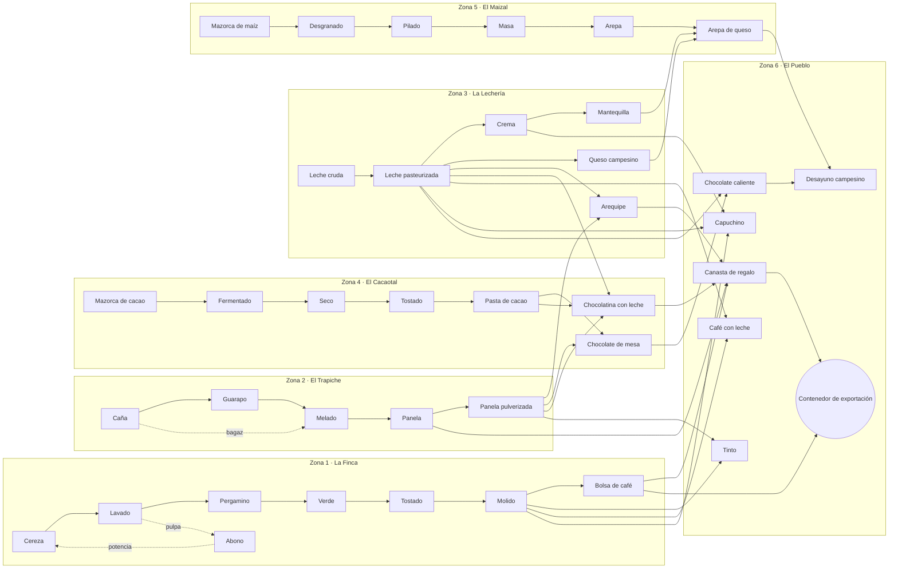

# Cafetal — Documento de Diseño (GDD) v0.3

> Juego incremental de **cadena de suministros**: un recurso inicial ilimitado pero lento alimenta a una estación, esa estación alimenta a la siguiente, y todo se mejora para producir cada vez más.
> De Frozen City solo se toman la cadena de producción visible y el estilo gráfico isométrico «de juguete», con personajes que llevan cargas.
> No hay supervivencia, ni clima hostil, ni población que alimentar, ni héroes.
> Una sola zona que se puede terminar y que se ampliará con actualizaciones. JavaScript (Vite + PixiJS).

---

## 1. Tema

Se buscó un tema en el que una cadena larga de transformación sea **natural y fácil de entender**, en el que cada paso **aumente el valor** del producto y en el que el origen sea **ilimitado**.

| Tema | Fuente ilimitada | Cadena | Notas |
|------|------------------|--------|-------|
| **Cafetal** (finca cafetera de montaña) | Cafeto (cerezas) | cereza → lavado → pergamino → verde → tostado → molido → bolsa | **Recomendado**: cadena real de 7 pasos, muy visual y con mucha identidad |
| Panadería de pueblo | Trigal | trigo → harina → masa → pan → pastel | Más corta, ideal si se quiere algo muy simple |
| Fábrica de chocolate | Cacaotal | cacao → fermentado → tostado → pasta → tableta → bombón | Muy parecida al café; buena como Zona 2 |
| Herrería minera | Veta de mineral | mineral → lingote → barra → pieza → herramienta | Tono más industrial |

**Se elige Cafetal** porque:
- La cadena real del café tiene muchos pasos con nombre propio, cada uno con su edificio reconocible.
- El paisaje cafetero (montañas verdes, niebla, casas de colores con balcones, palmas altas, mulas y jeeps Willys cargados) da un estilo gráfico propio y encantador.
- Las expansiones salen solas: tostaduría en el pueblo, cafetería con bebidas, puerto de exportación, cacao…

---

## 2. Concepto

> *Heredas una ladera con unos pocos cafetos y una mula. Cosecha, procesa y despacha café cada vez mejor hasta llenar tu primer contenedor de exportación.*

- **Género:** incremental / idle de cadena de producción.
- **Vista:** isométrica. La finca baja por la ladera: arriba el cafetal y abajo el pueblo donde se despacha. La cadena se lee de arriba abajo.
- **Sesiones:** cortas (de 2 a 10 min) o dejándolo correr. Ganancias sin conexión con un límite.
- **Zona 1:** de 3 a 5 horas hasta el objetivo final. **Tiene final**: no hay que esperar días.
- **Sin:** héroes, gacha, energía, anuncios ni pagos.

### Pilares
1. **Cada producto alimenta al siguiente.** Siempre se ve qué estación está esperando y cuál se está atascando.
2. **Mejorar siempre se nota.** Cada compra acelera algo de forma visible: más mulas, máquinas más rápidas, números más grandes.
3. **El cuello de botella se mueve.** Si arreglas uno, aparece otro más abajo. Ese es el juego.
4. **Pequeño y terminado.**

---

## 3. Bucle de juego

```
 Cafetal (ilimitado, lento)
      │  cerezas
      ▼
 Estación 2 ─► Estación 3 ─► … ─► Bodega ─► Despacho (Willys) ─► 💰 Monedas
      ▲                                                            │
      └──────────── Mejorar nivel / arrieros / desbloquear ◄───────┘
```

1. El **Cafetal** produce cerezas sin fin, pero despacio.
2. Cada **estación** transforma lo que recibe en un producto de mayor valor.
3. Los **arrieros** (mulas) llevan el producto de una estación a la siguiente.
4. Todo lo que llega a la **Bodega** lo vende el **Despacho** y se convierte en monedas.
5. Con las monedas se **mejora**, se **desbloquean** estaciones y se compran **investigaciones**.

**Decisión clave:** ¿mejoro producción, transporte o venta? El jugador busca el cuello de botella; la UI se lo marca.

---

## 4. La cadena (Zona 1)

| # | Estación | Entra | Sale | Ciclo (nv. 1) | Valor unidad | Desbloqueo | Coste base de mejora |
|---|----------|-------|------|---------------|--------------|------------|----------------------|
| 1 | **Cafetal** ♾️ | — | 1 🍒 cereza | 2 s | 1 | Inicial | 5 |
| 2 | Beneficiadero (despulpar y lavar) | 2 🍒 | 1 💧 grano lavado | 4 s | 3 | 50 | 8 |
| 3 | Marquesina de secado | 1 💧 | 1 🟫 pergamino | 4 s | 6 | 250 | 12 |
| 4 | Trilladora | 1 🟫 | 1 🟢 café verde | 4 s | 10 | 1.000 | 20 |
| 5 | Tostadora | 2 🟢 | 1 🟤 café tostado | 8 s | 30 | 4.000 | 35 |
| 6 | Molino | 1 🟤 | 1 ☕ café molido | 8 s | 45 | 15.000 | 60 |
| 7 | Empacadora | 4 ☕ | 1 🛍️ bolsa de café | 32 s | 250 | 60.000 | 100 |
| — | **Bodega + Despacho** | cualquier producto | 💰 | viaje de 10 s | — | Inicial | 10 |

> **Regla de balance (v0.2):** a igual nivel, cada estación procesa exactamente lo que le entrega la anterior (los ciclos se calcularon a partir de 0,5 🍒/s del Cafetal a nivel 1). Así, subir toda la cadena junta mantiene el flujo equilibrado y el cuello de botella aparece cuando una estación se queda atrás. Simulado: un jugador que sube la cadena en bloque construye la Empacadora a los ~67 min; uno que mejora estación por estación, a las ~2 h 20 min.

- **Al principio solo existen el Cafetal y el Despacho:** se venden cerezas a 1 💰. Desbloquear el Beneficiadero vuelve más rentable cada cereza, y así sucesivamente.
- **Cada paso aumenta el valor** más de lo que consume (2 🍒 = 2 → 1 💧 = 3), así que procesar siempre conviene, **si la estación da abasto**. Si no, el sobrante también se vende en crudo.
- **Desvío automático:** si una estación está llena o bloqueada, su entrada se desvía a la Bodega y se vende tal cual. La cadena nunca se atasca del todo; solo rinde menos. La UI lo muestra con una flecha naranja de desvío.

---

## 4b. Mapa completo de la cadena (todas las zonas)

Esto es el **techo del juego**: todo lo que existirá cuando estén las 6 zonas. Se construye por partes (la v1.0 solo trae la Zona 1), pero el diseño, los datos y el balance se piensan desde el principio para que todo encaje.

### Resumen en números

| Concepto | Cantidad |
|----------|----------|
| Zonas | **6** |
| Fuentes ilimitadas | **5** (cafetal, cañaduzal, potrero, cacaotal, maizal) |
| Productos en total | **41** |
| Estaciones (edificios de producción) | **39** |
| Subproductos que potencian otras estaciones | 2 (pulpa → abono, bagazo) |
| Productos que combinan varias zonas | 11 |
| Producto final del juego | **Contenedor de exportación** |
| Profundidad máxima (pasos desde una fuente hasta el final) | 9 |

### Vista general



### Detalle por zona

Los valores son orientativos y se ajustarán con el simulador de balance. ⇄ indica un producto importado de otra zona.

#### Zona 1 · La Finca (café) — 8 estaciones, 9 productos — **v1.0**
| # | Estación | Entrada | Salida | Valor |
|---|----------|---------|--------|-------|
| 1 | Cafetal ♾️ | — | Cereza de café | 1 |
| 2 | Beneficiadero | 2 cerezas | Café lavado + *pulpa* | 3 |
| 3 | Marquesina de secado | 1 lavado | Café pergamino | 6 |
| 4 | Trilladora | 1 pergamino | Café verde | 10 |
| 5 | Tostadora | 2 verde | Café tostado | 30 |
| 6 | Molino | 1 tostado | Café molido | 45 |
| 7 | Empacadora | 4 molido | Bolsa de café | 250 |
| 8 | Compostera *(rama opcional, v1.0)* | 5 pulpa (por canaleta, sin mulas) | Compost → Cafetal ×1,5 mientras haya (1 compost por 20 cerezas) | — |

#### Zona 2 · El Trapiche (caña y panela) — 5 estaciones, 6 productos — v1.1
| # | Estación | Entrada | Salida | Valor |
|---|----------|---------|--------|-------|
| 1 | Cañaduzal ♾️ | — | Caña | 2 |
| 2 | Molienda | 1 caña | Guarapo + *bagazo* | 5 |
| 3 | Hornilla | 2 guarapo (+ bagazo como combustible: ×2 de velocidad) | Melado | 12 |
| 4 | Gaveras (moldeo) | 2 melado | Panela | 30 |
| 5 | Pulverizadora | 1 panela | Panela pulverizada | 50 |

#### Zona 3 · La Lechería — 6 estaciones, 6 productos — v1.2
| # | Estación | Entrada | Salida | Valor |
|---|----------|---------|--------|-------|
| 1 | Potrero y establo ♾️ | — | Leche cruda | 5 |
| 2 | Pasteurizadora | 1 cruda | Leche pasteurizada | 12 |
| 3 | Descremadora | 3 pasteurizada | Crema de leche | 40 |
| 4 | Batidora | 2 crema | Mantequilla | 90 |
| 5 | Quesera | 6 pasteurizada | Queso campesino | 120 |
| 6 | Paila de arequipe | 4 pasteurizada + 1 panela pulverizada ⇄ | Arequipe | 200 |

#### Zona 4 · El Cacaotal (chocolate) — 7 estaciones, 7 productos — v1.3
| # | Estación | Entrada | Salida | Valor |
|---|----------|---------|--------|-------|
| 1 | Cacaotal ♾️ | — | Mazorca de cacao | 8 |
| 2 | Cajones de fermentación | 1 mazorca | Cacao fermentado | 20 |
| 3 | Secadero | 1 fermentado | Cacao seco | 35 |
| 4 | Tostador de cacao | 1 seco | Cacao tostado | 70 |
| 5 | Molino de cacao | 2 tostado | Pasta de cacao | 150 |
| 6 | Mesa de chocolate | 1 pasta + 1 panela pulverizada ⇄ | Chocolate de mesa | 400 |
| 7 | Chocolatería | 1 pasta + 1 panela pulverizada ⇄ + 2 leche pasteurizada ⇄ | Chocolatina con leche | 900 |

#### Zona 5 · El Maizal (arepas) — 6 estaciones, 6 productos — v1.4
| # | Estación | Entrada | Salida | Valor |
|---|----------|---------|--------|-------|
| 1 | Maizal ♾️ | — | Mazorca de maíz | 6 |
| 2 | Desgranadora | 1 mazorca | Maíz desgranado | 12 |
| 3 | Piladora | 1 desgranado | Maíz pilado | 25 |
| 4 | Molino de masa | 2 pilado | Masa de maíz | 50 |
| 5 | Budare | 1 masa | Arepa | 100 |
| 6 | Puesto de arepas | 1 arepa + 1 queso ⇄ + 1 mantequilla ⇄ | Arepa de queso | 600 |

#### Zona 6 · El Pueblo (ensamble final, sin fuente propia) — 7 estaciones, 7 productos — v1.5
Es la única zona sin recurso ilimitado: **todo llega importado**. Es el «examen final» de la logística entre zonas.

| # | Estación | Entrada | Salida | Valor |
|---|----------|---------|--------|-------|
| 1 | Greca de tintos | 1 café molido ⇄ + 1 panela pulverizada ⇄ | Tinto | 300 |
| 2 | Cafetera de leche | 1 molido ⇄ + 2 pasteurizada ⇄ | Café con leche | 500 |
| 3 | Máquina espresso | 1 molido ⇄ + 1 pasteurizada ⇄ + 1 crema ⇄ | Capuchino | 1.200 |
| 4 | Chocolatera | 1 chocolate de mesa ⇄ + 2 pasteurizada ⇄ | Chocolate caliente | 1.500 |
| 5 | Fonda | 1 arepa de queso ⇄ + 1 chocolate caliente | Desayuno campesino | 5.000 |
| 6 | Taller de canastas | 1 bolsa de café ⇄ + 2 panela ⇄ + 1 arequipe ⇄ + 2 chocolatinas ⇄ | Canasta de regalo | 20.000 |
| 7 | Muelle de exportación | 250 canastas + 2.000 bolsas de café ⇄ | **Contenedor de exportación** | Final del juego |

### Cómo viajan los productos entre zonas
- Cada zona tiene una **Bodega de salida**. Entre zonas hay **rutas** con su propio transporte mejorable: **Willys** al principio, **chiva** (más carga) y finalmente **camión**.
- Una ruta se configura así: *producto X, de la Zona A a la Zona B*. Igual que los arrieros dentro de una zona, la ruta tiene capacidad por minuto y puede ser el cuello de botella.
- **Cada zona sigue siendo jugable sola:** si no llega el importado, las estaciones que lo necesitan se pausan, pero el resto de la cadena produce y vende normalmente.
- **Al completar una zona** se desbloquea la siguiente y la anterior sigue produciendo en segundo plano, como si estuviera sin conexión.

### Orden de llegada (por qué este orden)
1. **Finca:** cadena lineal pura, enseña lo básico.
2. **Trapiche:** introduce los **subproductos** (bagazo) y es el primer proveedor de otras zonas.
3. **Lechería:** introduce la **ramificación** (una leche con 4 destinos) y la **primera importación** (arequipe).
4. **Cacaotal:** combina 2 y 3 importaciones en una sola receta.
5. **Maizal:** recetas con ingredientes de varias zonas en el producto estrella.
6. **Pueblo:** todo importado; pone a prueba la red completa.

---

## 5. Mejoras

Cada estación tiene **dos ejes** de mejora.

### 5.1 Nivel de producción (1–100)
- **Velocidad:** `vel(L) = base × (1 + 0,15 × (L − 1)) × 2^hitos`.
- **Hitos** en los niveles 10, 25, 50, 75 y 100: la velocidad se **duplica** y el edificio cambia de aspecto (ver §8).
- **Coste:** `coste(L) = costeBase × 1,15^(L − 1)`.
- Botones de compra ×1, ×10 y «máx».

### 5.2 Arrieros (transporte hacia la siguiente estación)
- Cada estación tiene sus propias mulas. Una mula carga, va a la siguiente estación (o a la bodega si la siguiente no existe o tiene la entrada llena), entrega y **vuelve vacía**.
- Los arrieros tienen su propio **nivel (1–100)**, que cuesta la mitad que el de la estación:
  - **Mulas** = 1 + una más cada 10 niveles (máx. 10).
  - **Carga por mula**: crece con el nivel y se duplica en los mismos hitos que la estación.
- **Capacidad del tramo** = mulas × carga / tiempo de ida y vuelta. Está calibrada para que, a igual nivel, mueva un 25 % más de lo que produce la estación en un tramo de 6 s de ida y vuelta: los tramos cortos sobran, los largos (y sobre todo los desvíos a la bodega) se quedan cortos.
- Si todas las mulas están en camino, el producto se acumula en el **patio** (sacos apilados). Cuando se llena, la estación se detiene (⛔).
- Al empezar, con solo el Cafetal, la única mula tiene que llegar hasta la bodega: el primer cuello de botella son los arrieros, y así se enseña la mecánica.
- **Vista «Ver cadena» (🔗)**: muestra por estación lo que recibe, procesa y produce, y por tramo lo que llevan los arrieros, lo que se desvía y lo que se pierde, con el cuello de botella en rojo.

### 5.3 Despacho
- Un **Willys** lleva `N` unidades de la Bodega al pueblo y vuelve. Se puede mejorar la capacidad, la velocidad y comprar más jeeps (máx. 5).
- Es el último cuello de botella. Al principio sobra; con 7 estaciones a buen nivel se vuelve crítico.

### 5.4 Investigaciones (compras únicas y globales, v0.5)

Aparecen al construir la estación indicada (`src/data/research.js`):

| Investigación | Efecto | Coste | Aparece con |
|---------------|--------|-------|-------------|
| 🌱 Abono orgánico | Cafetal ×2 | 300 | Beneficiadero |
| 🐴 Herraduras | Mulas ×1,5 de velocidad | 900 | Marquesina |
| 🚙 Remolque para el Willys | Despacho ×2 de carga | 2.500 | Trilladora |
| ♨️ Secador mecánico | Marquesina ×2 | 6.000 | Trilladora |
| 🧑‍🌾 Capataz | Ganancias sin conexión: de 2 h a 6 h | 10.000 | Tostadora |
| 🔥 Tueste de origen | Café tostado +50 % de valor | 20.000 | Tostadora |
| 🌳 Variedad Castillo | Cafetal ×2 | 50.000 | Molino |
| 🚡 Cable aéreo | Mulas ×2 de velocidad | 120.000 | Empacadora |
| 🏅 Sello de calidad | Bolsas +50 % de valor | 300.000 | Empacadora |

### 5.5 Mejora recomendada
El aviso de arriba recomienda la mejora que más 💰/s añade por moneda gastada (estaciones, arrieros y despacho). Si ninguna mejora suelta rinde (hay que subir varias juntas), recomienda el cuello de botella. La vista «La cadena» sigue marcando el cuello de botella en rojo.

### 5.6 Desvíos y bodega
Lo que se desvía a la bodega solo puede ocupar hasta el 70 % de su capacidad: el 30 % restante queda siempre libre para el producto final de la cadena, para que el producto barato que sobra no atasque la Empacadora.

---------------|--------|--------------|
| Abono orgánico | Cafetal ×2 | 1.000 |
| Variedad Castillo | Cafetal ×2 | 50.000 |
| Secador mecánico | Marquesina ×3 | 30.000 |
| Tueste de origen | +50 % de valor del tostado | 200.000 |
| Sello de calidad | +50 % de valor de las bolsas | 2.000.000 |
| Cable aéreo | Arrieros del tramo más largo ×2 de velocidad | 500.000 |
| Capataz | Ganancias sin conexión: de 2 h a 6 h | 100.000 |

---

## 6. Objetivos y final de la zona

Una lista de **29 objetivos en orden** (`src/data/goals.js`). Se ven 3 a la vez, el primero también en un marcador abajo a la izquierda, y al cumplirse se **cobran** (dan monedas). Tipos: vender o producir N de un producto, subir algo a un nivel, construir una estación, investigar, ganar N 💰/s y subir todas las estaciones a un nivel.

**Final de la Zona 1: «Primer gran pedido»**, vender 1.000 bolsas de café. Al cobrarlo aparece la pantalla de «Zona completada» con las estadísticas y el anuncio de la Zona 2; se puede seguir jugando en modo libre.

**Balance medido** con `npm run balance` (jugador automático, ver `tools/balance-sim.js`):

| Jugador | Empacadora | Zona completada |
|---------|-----------|-----------------|
| Atento: sube toda la cadena junta y elige la compra más rentable | ~57 min | **~1 h 22 min** |
| Casual: sigue la mejora recomendada y los objetivos, ahorra para construir si le queda cerca | ~2 h 50 min | **~3 h 30 min** |

## 7. Ganancias sin conexión

Al volver se **simula** el tiempo que el juego estuvo cerrado en pasos de 1 s, con un máximo de 2 h (6 h con el Capataz). Seis horas se calculan en unos 0,2 s y el resultado coincide con jugar en vivo (hay una prueba que lo verifica). Se muestra una ventana de bienvenida con lo ganado y si se alcanzó el tope.

---

## 8. Dirección de arte (estilo Frozen City, ambientación cafetera)

### Lo que se toma de Frozen City
- Isométrico limpio, con edificios «de juguete», volúmenes sencillos, contornos suaves y sombras proyectadas.
- **Vida pequeña por todas partes:** personajes y animales que caminan llevando cargas visibles, máquinas que se mueven, humo y números flotando.
- **Los edificios crecen con el nivel:** cada hito cambia el modelo (cobertizo → casa → fábrica).
- UI gruesa y amable: paneles redondeados, iconos grandes y botones que rebotan.

### Ambientación
- Ladera verde en diagonal, con el cafetal arriba y el pueblo abajo. Un camino de tierra en zigzag une las estaciones.
- Fondo: montañas en capas con niebla, palmas de cera altas y nubes que pasan.
- Las estaciones son casas campesinas de colores: blanco con zócalo, puertas y balcones de madera pintados de rojo, azul, amarillo o verde, y tejas de barro.
- **Arrieros:** mulas con costales y un campesino de sombrero aguadeño y poncho.
- **Despacho:** un jeep Willys cargado hasta arriba bajando la carretera.
- Día y noche **solo cosmético**: amanecer con niebla, día brillante y noche con faroles cálidos y ventanas iluminadas.

### Evolución visual por hitos (implementado en la v0.4)
Cada estación conserva su dibujo propio y va ganando detalles con cada hito:

| Hito | Nivel | Qué cambia |
|------|-------|------------|
| 1 | 10 | Macetas con flores y remates de otro color |
| 2 | 25 | Segundo piso con balcón (la Marquesina gana una cama más, la rueda del Molino crece) |
| 3 | 50 | Dos faroles que se encienden de noche |
| 4 | 75 | Patio empedrado |
| 5 | 100 | Bandera de Colombia ondeando en el tejado y remates dorados |

La casa del Cafetal evoluciona aparte (de rancho de madera a casa de dos pisos con balcón).

### Día y noche (v0.4)
- Un día dura 8 minutos de juego; una partida nueva empieza a las 8:00.
- El mundo se tiñe (amanecer rosado, atardecer naranja, noche azul) y el cielo cambia de degradado. Las estrellas, ventanas, faroles, el fuego de la Tostadora y las luciérnagas brillan de noche.
- **Solo es decorativo**: no cambia la producción.

### Sonido (v0.4)
Sintetizado con Web Audio, sin archivos: clic de botones, monedas al vender, arpegio al subir de nivel y al cruzar un hito, martillazos al construir, pájaros de día y grillos de noche. Se apaga desde el menú y la preferencia se guarda con la partida.

### Paleta

| Uso | Hex |
|-----|-----|
| Cafetal verde (luz) | `#7DBA4E` |
| Cafetal verde (sombra) | `#4E7F33` |
| Montaña lejana | `#8FB3A0` → `#C9DCCF` (niebla) |
| Cereza roja | `#D7263D` |
| Café tostado | `#6B3E26` |
| Tierra del camino | `#C79A64` |
| Pared encalada | `#F4EFE6` |
| Teja | `#B5512E` |
| Balcones | `#2E6FD1` · `#E8B90F` · `#D7263D` · `#2FA36B` |
| Contorno | `#3A2418` (60 %) |
| Cielo de día | `#BFE3F2` |
| Atardecer | `#F6B26B` → `#E07A5F` |
| Noche (tinte) | `#2B2D5B` (multiply, 40 %) |
| Farol | `#FFC864` (glow) |

### Reglas visuales
- **Casillas:** rombos de 64×32 px. Las estaciones ocupan 3×3 casillas.
- **Sombreado:** cara superior = base, izquierda = −15 % de luz, derecha = −30 %.
- **Personajes:** de 16×24 px, cabeza grande y caminata de 3 fotogramas; mulas de 24×20 px con los costales de un color distinto según el producto.
- **Efectos:**
  - Número flotante «+250 💰» al vender.
  - Monedas que saltan del Willys al llegar al pueblo.
  - Humo en la tostadora, vapor en el beneficiadero y granos esparcidos en la marquesina.
  - Destello y pequeño rebote al subir de nivel; confeti y cambio de modelo en cada hito.
  - **Indicadores de estado sobre cada estación:** ⏸️ esperando entrada · ⛔ salida llena · ↪️ desviando a bodega.
- **UI:**
  - Barra superior: 💰 y 💰/s.
  - Panel inferior de la estación seleccionada: nivel, velocidad, buffers, arrieros, botones de mejora ×1/×10/máx.
  - Lateral: objetivos.
  - Botón «Ver cadena»: un diagrama compacto con el flujo/s de cada tramo y el cuello de botella resaltado en rojo.
  - Fuente: **Fredoka** o **Baloo 2**.

### Producción del arte sin artista
1. **v0.1–0.3:** todo se dibuja por código (cajas isométricas, techos de dos aguas, arbustos redondos con puntos rojos para los cafetos). Rápido y coherente.
2. **v0.4+:** sustituir por sprites PNG estación a estación. Cada estación declara su `sprite` por hito en los datos, así que la lógica no cambia.

---

## 9. Arquitectura técnica

- **Stack:** JavaScript (ES modules), Vite y PixiJS v8.
- **Sin servidor:** se guarda en `localStorage` como JSON versionado, con exportar e importar en texto.
- **La simulación y el dibujo van separados:**
  - La simulación avanza a tick fijo (10/s), es pura y se puede probar con Node.
  - El dibujo solo lee el estado.
- **Todo el contenido son datos:** recursos, estaciones, mejoras, investigaciones, objetivos y zonas están en `src/data/`. Una zona nueva = un archivo nuevo.
- **Números grandes:** con `Number` alcanza hasta unos 1e15 en la Zona 1. El formato es 1,2K · 3,4M · 5,6B. Si las zonas futuras lo exigen, se cambiará a `break_infinity.js`.

### Carpetas

```
/
├─ index.html
├─ package.json
├─ vite.config.js
├─ docs/GDD.md
├─ tools/
│  └─ balance-sim.js        # simula N horas con una estrategia "codiciosa" e imprime tiempos de cada hito
└─ src/
   ├─ main.js
   ├─ core/
   │  ├─ Game.js            # estado + bucle de tick fijo
   │  ├─ EventBus.js
   │  ├─ SaveSystem.js
   │  └─ format.js          # 1,2K / 3,4M
   ├─ sim/                  # lógica pura (sin DOM ni Pixi)
   │  ├─ stations.js        # ciclos, buffers, recetas, desvío
   │  ├─ transport.js       # arrieros por tramo
   │  ├─ dispatch.js        # bodega + Willys → monedas
   │  ├─ upgrades.js        # costes, hitos, investigaciones
   │  ├─ goals.js
   │  └─ offline.js         # flujo estable × tiempo
   ├─ data/
   │  ├─ products.js
   │  ├─ stations.js
   │  ├─ research.js
   │  ├─ goals.js
   │  └─ zones/zone1_finca.js   # posiciones de estaciones y camino
   ├─ render/
   │  ├─ iso.js
   │  ├─ Camera.js
   │  ├─ TerrainRenderer.js
   │  ├─ StationRenderer.js
   │  ├─ CarrierRenderer.js     # mulas y Willys siguiendo el camino
   │  ├─ Effects.js             # números flotantes, humo, confeti
   │  ├─ DayNight.js
   │  └─ procedural/
   └─ ui/
      ├─ HUD.js
      ├─ StationPanel.js
      ├─ ChainView.js           # diagrama del flujo y cuello de botella
      ├─ GoalsPanel.js
      └─ styles.css
```

### Ejemplo de datos

```js
// src/data/stations.js
export const STATIONS = [
  {
    id: 'farm', name: 'Cafetal', infinite: true,
    out: { cherry: 1 }, cycle: 2.0,
    unlockCost: 0, upgradeBase: 5,
    sprites: ['farm_0', 'farm_10', 'farm_25', 'farm_50', 'farm_75'],
  },
  {
    id: 'wetmill', name: 'Beneficiadero',
    in: { cherry: 2 }, out: { washed: 1 }, cycle: 3.0,
    unlockCost: 50, upgradeBase: 40,
  },
  // ...
];

export const MILESTONES = [10, 25, 50, 75, 100]; // ×2 de velocidad en cada uno
export const COST_GROWTH = 1.15;
```

---

## 10. Hoja de ruta

| Versión | Contenido | Resultado jugable |
|---------|-----------|-------------------|
| **v0.1** ✅ | Mapa isométrico, cámara, Cafetal + Despacho, mejora de nivel, HUD de monedas | Producir cerezas, venderlas y mejorar |
| **v0.2** ✅ | Las 7 estaciones, recetas, buffers, desvío a bodega, desbloqueos | La cadena completa funciona |
| **v0.3** ✅ | Arrieros reales por el camino, mejoras de transporte, Willys, indicadores de estado, vista «Ver cadena» | Los cuellos de botella son visibles |
| **v0.4** ✅ | Hitos con cambio de modelo, efectos, día y noche cosmético, sonido básico | Se siente vivo, al estilo Frozen City |
| **v0.5** ✅ | Objetivos, investigaciones, guardado, ganancias sin conexión, simulador de balance | Se juega de principio a fin |
| **v1.0** | Contenedor de exportación, pantalla final y balance ajustado | **Zona 1 completa** |
| v1.1 | **Zona 2: El Trapiche**: caña → panela; subproducto bagazo; primera ruta entre zonas | Expansión |
| v1.2 | **Zona 3: La Lechería**: ramificación de la leche; arequipe con panela importada | Expansión |
| v1.3 | **Zona 4: El Cacaotal**: chocolate de mesa y chocolatina | Expansión |
| v1.4 | **Zona 5: El Maizal**: arepas y arepa de queso | Expansión |
| v1.5 | **Zona 6: El Pueblo**: cafetería, fonda y Contenedor de exportación (**final del juego**) | Expansión final |

**Cómo se conectan las zonas:** ver §4b.

---

## 11. Fuera de alcance

Supervivencia, clima que afecte a la economía, población con necesidades, héroes, combate, gacha, energía, multijugador, tienda con dinero real, prestigio o reinicio (quizá más adelante, por zona) y servidor.

---

## 12. Decisiones abiertas

1. ¿Cafetal o prefieres otra cadena (panadería, chocolate, herrería)?
2. ¿Escritorio primero (recomendado) o móvil vertical?
3. ¿Nombre? *Cafetal*, *Del Grano a la Taza*, *Finca*, *Arrieros*.
4. ¿Interfaz solo en español o también en inglés?
